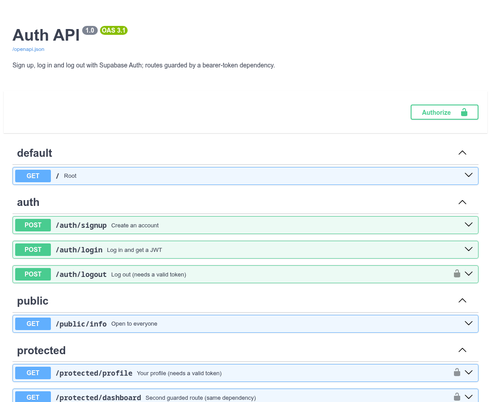
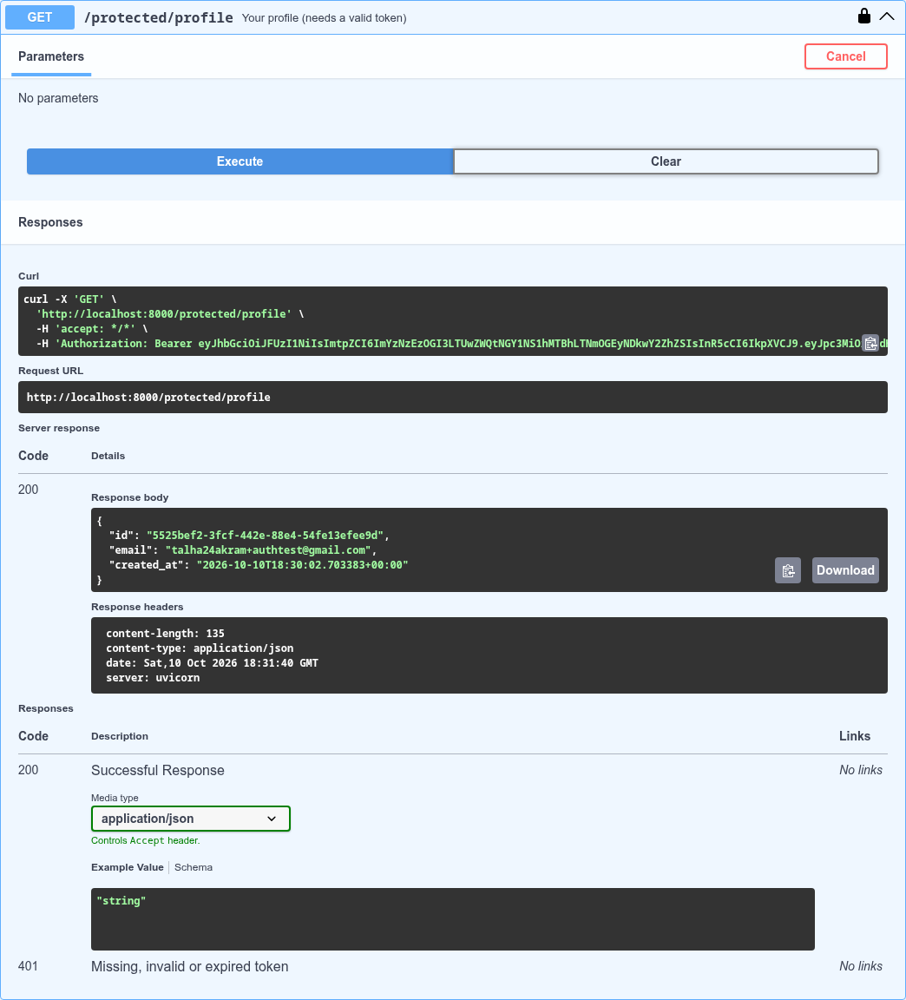

# Auth API (FastAPI + Supabase Auth)

A small API where **Supabase** owns accounts, password hashing and token signing, and this
server only forwards credentials and **verifies the tokens** Supabase hands back.
Protected routes sit behind one FastAPI dependency (`current_user`) that calls
`supabase.auth.get_user(token)`, so a forged or expired token never reaches a handler.

## Setup
1. Create a Supabase project, then copy **Project URL** and the **anon** key
   (Project Settings → API). Never use the `service_role` key.
2. In Authentication → Sign In / Providers → Email, turn **Confirm email** off (practice project only).
3. `cp .env.example .env` and fill in `SUPABASE_URL` and `SUPABASE_KEY` (`.env` is git-ignored).

## Run
```bash
python -m venv .venv && .venv/bin/pip install -r requirements.txt
.venv/bin/python main.py        # http://localhost:8000  (Swagger UI at /docs)
```

## Endpoints
| Method | Path | Auth | Notes |
|---|---|---|---|
| GET | `/` | no | health/hello |
| POST | `/auth/signup` | no | body `{email, password}` → 201; 400 on missing fields or Supabase error |
| POST | `/auth/login` | no | → 200 `{access_token, refresh_token, token_type, expires_in}`; 401 on bad credentials |
| GET | `/public/info` | no | anyone can call it |
| GET | `/protected/profile` | **Bearer** | returns the user's id and email |
| GET | `/protected/dashboard` | **Bearer** | second protected route behind the same guard |
| POST | `/auth/logout` | **Bearer** | revokes the session → 204 |

Errors use one shape: `{"error": "..."}`.

## Try it
```bash
curl -s -X POST localhost:8000/auth/signup -H 'content-type: application/json' -d '{"email":"a@example.com","password":"Passw0rd!x"}'
TOKEN=$(curl -s -X POST localhost:8000/auth/login -H 'content-type: application/json' -d '{"email":"a@example.com","password":"Passw0rd!x"}' | python -c 'import sys,json;print(json.load(sys.stdin)["access_token"])')
curl -s localhost:8000/protected/profile -H "Authorization: Bearer $TOKEN"
```

## Swagger UI
Locks on the protected routes; click **Authorize**, paste the access token, then **Try it out**.




## 401 vs 403
- **401 Unauthorized**: we don't know who you are (no token, malformed, expired, tampered).
  This API returns 401 for every token problem.
- **403 Forbidden**: we know who you are but you aren't allowed. Not used here since there are no roles yet.
